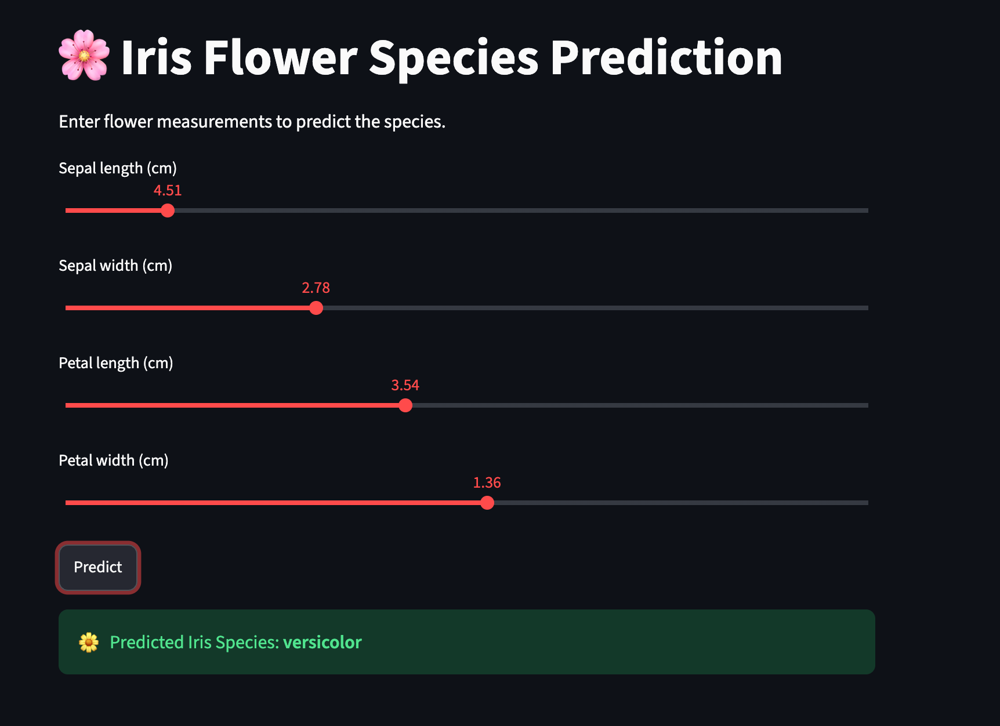

# 🌸 Iris Flower Species Prediction

A Streamlit web app that predicts the species of an Iris flower (setosa, versicolor or virginica) from four measurements.

**Live demo:** https://iris-app-3pws3sj7kyzbvaz6ghejto.streamlit.app/



## Features
- Four sliders for sepal length, sepal width, petal length and petal width
- Predict button that shows the predicted species
- Random Forest model trained on the scikit-learn Iris dataset when the app starts

## Model
I trained and compared several classifiers in Google Colab: Logistic Regression, KNN, SVM, Naive Bayes, Decision Tree, Random Forest, AdaBoost and XGBoost. Almost all scored 100% on a 30-sample test set (AdaBoost 93%). Because Iris is small and easy, the models are hard to tell apart. The deployed app uses **Random Forest**, which is simple to deploy and performed the same as the others.

## Tech stack
Python, NumPy, scikit-learn, Streamlit

## Project structure
```
iris-app/
├── app.py              # Streamlit app
├── requirements.txt    # Dependencies
├── output.png      # App screenshot
└── IRIS_DATASET.ipynb  # Training notebook
```

## Run locally
```bash
git clone https://github.com/lahari03m/iris-app.git
cd iris-app
pip install -r requirements.txt
streamlit run app.py
```

## Author
Lahari Makkapati · www.linkedin.com/in/lahari-makkapati-2349aa41a
